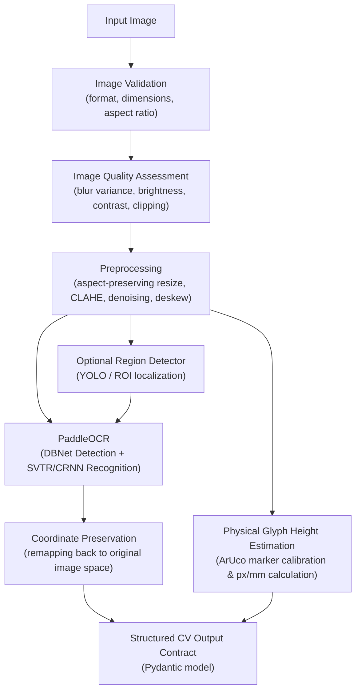

# LabelIntel — AI-Assisted Packaged Commodity Inspection System

LabelIntel is an automated compliance verification platform designed for statutory packaging inspections under the **Legal Metrology (Packaged Commodities) Rules, 2011** and relevant regulatory standards (including FSSAI packaging guidelines).

The system automates the inspection of mandatory packaged declarations (MRP, Net Quantity, Dates of Manufacture/Packaging/Expiry, Manufacturer & Consumer Care Details, and statutory physical glyph heights).

---

## 1. System Architecture

The project is structured into modular processing engines:

```
LabelIntel/
├── backend/               # FastAPI backend services, REST endpoints, database models
├── engines/
│   ├── cv_engine/         # Computer Vision: Validation, Quality, Preprocessing, OCR, Physical Measurements
│   ├── nlp_engine/        # NLP: Declaration classification, regex, entity extraction, normalization
│   ├── fusion/            # Multi-modal fusion & cross-verification layer
│   └── compliance_engine/ # Rule-based Legal Metrology compliance checks & violation scoring
├── frontend/              # React + Vite + TypeScript + Tailwind UI (Canvas/SVG label annotation)
├── data/
│   ├── samples/           # Canonical test packaging images
│   ├── models/            # Local model weights and inference configurations
│   ├── uploads/           # Raw inspection uploads
│   ├── processed/         # Preprocessed and annotated intermediate images
│   └── references/        # Regulatory rule tables and standard unit definitions
├── reports/               # Generated inspection reports (PDF / JSON)
├── scripts/               # Utility scripts and dataset verification tools
└── tests/                 # Unit, integration, and contract test suites
```

---

## 2. Hardware & Environment Specifications

- **Target Hardware:** HP Victus Laptop
- **GPU:** NVIDIA GeForce RTX 4050 Laptop GPU (6GB VRAM, Compute Capability 8.9)
- **NVIDIA Driver:** 616.92 (Supports CUDA up to 13.4 runtime)
- **Host OS:** Windows 11
- **Python Runtime:** Python 3.10.11
- **Node.js Runtime:** Node.js v22.21.0 / npm 10.9.4

---

## 3. Computer Vision Engine Design

The CV engine executes a deterministic, multi-stage pipeline:



### Key Principles:
1. **Zero Single-Point-of-Failure:** Full-image OCR fallback is mandatory. The system never halts or fails if a secondary YOLO declaration detector is absent or uncertain.
2. **Confidence vs Accuracy:** OCR confidence scores measure model text decoding certainty, not factual compliance accuracy. Semantic validation is deferred to the NLP and Compliance engines.
3. **Calibrated Physical Measurements:** Bounding box pixel height does not equal physical font glyph height. Physical millimeter calculations require explicit optical calibration (e.g., ArUco reference markers).

---

## 4. Setup & Installation

### Step 1: Create and Activate Virtual Environment
```powershell
python -m venv .venv
.\.venv\Scripts\Activate.ps1
```

### Step 2: Install CV Engine Baseline Dependencies
```powershell
pip install -r requirements-cv.txt
```

### Step 3: Run Baseline Verification Tests
```powershell
pytest tests/
```
