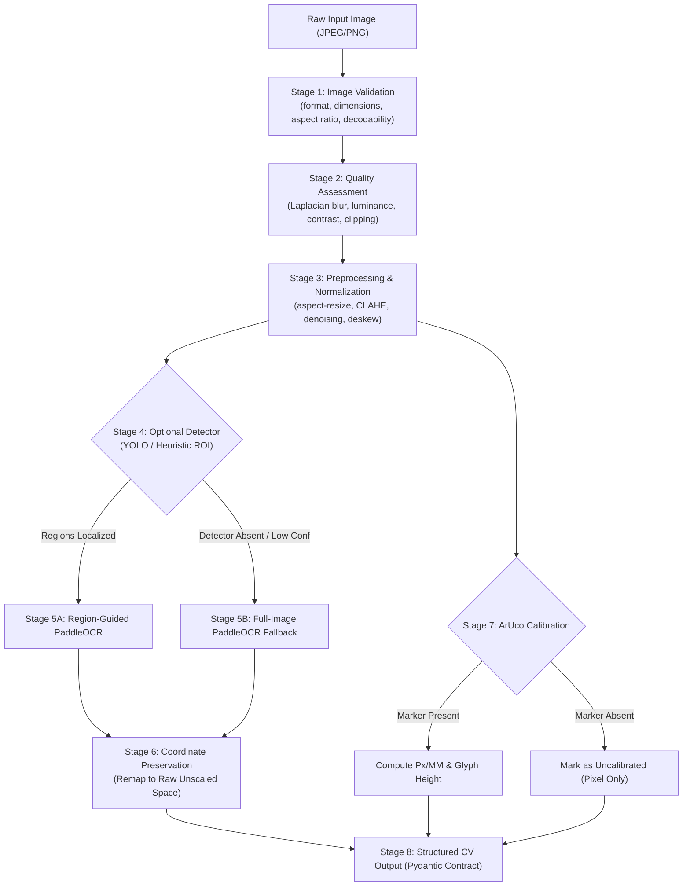

# LabelIntel — Computer Vision Engine Architecture & Pipeline Specification

## 1. Executive Summary & Objective

The **LabelIntel Computer Vision (CV) Engine** is responsible for transforming raw photographic captures of packaged commodities into validated, high-fidelity, coordinate-preserved, and optically calibrated textual and spatial representations.

The CV engine operates under a **Deterministic Fallback Hierarchy**: it guarantees complete text extraction via full-frame OCR even if upstream object detection or region-of-interest (ROI) classification is unavailable, uncertain, or degraded.

---

## 2. Multi-Stage Pipeline Architecture

---

## 3. Detailed Stage Specifications

### Stage 1: Image Validation
- **Formats Allowed:** JPEG (`.jpg`, `.jpeg`), PNG (`.png`), WebP (`.webp`).
- **Dimension Guards:**
  - Minimum: 100 x 100 pixels (images below this are rejected as unreadable).
  - Maximum: 4096 x 4096 pixels (higher resolutions undergo aspect-preserving downscaling to prevent OOM errors).
- **Aspect Ratio Guard:** Extreme aspect ratios ($> 1:10$ or $< 10:1$) raise validation errors as non-standard packaging crops.
- **Header Integrity:** Verify image array decodability via OpenCV (`cv2.imdecode` / `cv2.imread`) to catch corrupted payloads immediately.

### Stage 2: Image Quality Assessment
- **Blur Estimation:** Modified Laplacian variance $\sigma^2_{\nabla^2}$.
  - Threshold: $\sigma^2 < 100.0$ flags the image as blurry (`is_blurry = True`).
- **Luminance & Contrast:**
  - Mean luminance $\mu < 40$ flags underexposure; $\mu > 220$ flags overexposure.
  - Standard deviation $\sigma < 25$ flags low contrast.
- **Histogram Clipping:**
  - Percent of pixels $\le 5$ (shadow clipping) and $\ge 250$ (highlight burnout).
- **Non-blocking Behavior:** Quality issues generate structured warnings in `ImageQualityMetrics` rather than aborting the pipeline, allowing downstream triage.

### Stage 3: Preprocessing Pipeline
- **Aspect-Preserving Resize:** Standardize maximum dimension to 1920px while tracking exact scale factors ($s_x, s_y$).
- **Illumination Equalization:** Contrast Limited Adaptive Histogram Equalization (CLAHE) on the LAB L-channel (`clipLimit=2.0`, `tileGridSize=(8,8)`).
- **Denoising:** Bilateral filtering or Fast Non-Local Means (`cv2.fastNlMeansDenoisingColored`) preserving edge sharpness.
- **Deskewing:** Text orientation detection via DBNet angle classification or minimum-area bounding box on thresholded text lines.

### Stage 4 & 5: Declaration Localization & OCR
- **PaddleOCR Engine:**
  - Text Detection: DBNet (`ch_PP-OCRv4_det` or `en_PP-OCRv4_det`).
  - Direction Classifier: Text line angle rectifier (`ch_ppocr_mobile_v2.0_cls`).
  - Text Recognition: SVTR/CRNN architecture (`ch_PP-OCRv4_rec` / `en_PP-OCRv4_rec`).
- **Fallback Rule:** If an optional YOLO declaration detector is enabled, detected bounding boxes are cropped with 10% padding for localized OCR. If the detector finds no declarations or fails, the pipeline seamlessly switches to full-image OCR.

### Stage 6: Coordinate Preservation
- Every bounding polygon $(x_i, y_i)$ extracted on preprocessed or cropped patches is inverted back through the scale factors, deskew rotation matrix, and crop offsets.
- **Guarantee:** All coordinates in `OCRTextBlock.polygon` and `OCRTextBlock.bounding_box` strictly represent pixel positions in the **original, unscaled raw image**.

### Stage 7: Physical Character-Height Measurement (ArUco Calibration)
- **Problem Statement:** Indian Legal Metrology Rules specify mandatory minimum font glyph heights (e.g. 1.0 mm, 2.0 mm, 4.0 mm, 6.0 mm depending on package net quantity).
- **Critical Technical Distinction:** Bounding box pixel height $\ne$ typographical glyph x-height/cap-height. Bounding boxes include ascenders, descenders, and line spacing padding.
- **ArUco Calibration:**
  - Using OpenCV ArUco detector (`DICT_4X4_50` or `DICT_5X5_50`).
  - Known physical square dimension $D_{mm}$ (default: 20.0 mm).
  - Detected corner perimeter $P_{px} \implies \text{pixels\_per\_mm} = \frac{P_{px}}{4 \cdot D_{mm}}$.
  - Glyph height estimation: Extract individual line binarized contours within the OCR box; measure median contour height $H_{px}$; compute physical height $H_{mm} = \frac{H_{px}}{\text{pixels\_per\_mm}}$.
  - If no marker is detected, the status remains `uncalibrated` and physical mm measurements are set to `None`.
